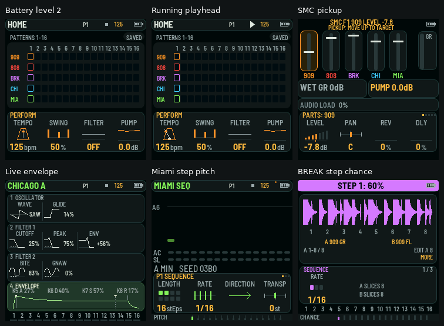

# Firmware UI lane

Integ merged [PR #975](https://github.com/gobbajogger/DnBOX/pull/975) into `integration/dnbox-consolidated` on 21 November 2026. The merge and qualified PR head have identical trees. All 37 focused host registrations and both stock builds passed on `9dd6f2df`. All four F5 registrations passed on integration merge `3e307cfa`. The initial unfiltered run recorded 85 outcomes. The remaining registrations were assigned to continuations at the same merge. [Merge](https://github.com/gobbajogger/DnBOX/commit/3e307cfa455d22dfca5e4ef439080816b4e4f859) · [Qualification record](fwui/current/integration-qualification.json)

## Find a screen

The [screen guide](fwui/screens/README.md) and [searchable catalog](fwui/screens/screen-index.tsv) link 1,944 records and cover normal startup, pending-sample recovery, calibration, updater, safe mode, playing states and both bass editors. The catalog records the source, archive or direct PNG path, and decoded RGB hash for each native 240×240 capture. The two retired stock placeholder pages retain their earlier hashes under `history/`.

| Route | Controls and behavior |
|---|---|
| Startup and recovery | Follow the splash to the first sequencer frame. Recovering a pending BREAK sample restores all 4,096 bytes. The first ordinary screen matches the already-restored control. The two octave buttons enter the update countdown. [Startup captures](fwui/current/native-routes/normal-loop/normal-loop.json) |
| Stock Synth One | On either bass part, press **PARA**, turn **K2** to SOUND and select SYNTH ONE with **K5**. The panel shows the engine, preset and actual application state. **SCALE** opens the three-entry list. [Fourteen native frames](fwui/current/panel-routes/stock-init/frames.json) |
| Optional Synth One | On a build with Sound #973 and the patch enabled, **K2** chooses the oscillator, filter, two envelope pages or SOUND. **K5–K8** edit the mapped controls. **SCALE**, **K2** and **K3** open, select and edit the real factory IDs. Both owners have independent state. [Controls and ranges](fwui/current/synthone-editor/README.md) · [122 native captures](fwui/current/synthone-editor/routes.json) |
| Compact SuperJ6 | Choose SUPERJ6 in SOUND. **K4** or **K6** selects one of the four stock presets. Each bass part has sixteen real DSP controls, plus the full parameter list. All 6,291,456 stereo frames in the parameter sweep matched the original compact engine. [Controls and audio comparison](fwui/current/superj6-slot/README.md) · [28 native captures](fwui/current/superj6-slot/frames.json) |

The last bank keeps the previous rows visible and editable. Two- and three-control rows use the available width. Drum and bass parameter lists show up to nine real entries and distribute short lists across their available height.

## Stock memory

| Firmware source | Elite XIP free | Pro XIP free | Pool margin on both |
|---|---:|---:|---:|
| Starting PR head `3e67b59c` | 4,056 B | 4,064 B | 780 B |
| Stock firmware tree `3a81c6fe` | 1,148 B | 1,156 B | 780 B |
| Same tree with Sound, patch off | 6,172 B | 6,180 B | 780 B |
| Same tree with Sound, patch on | 2,632 B | 2,644 B | 780 B |

The stock thresholds require at least 1,024 B free XIP and 512 B above the 8,192 B pool reserve. Sharing Chicago and Miami’s identical 128-word pitch table recovered 512 B. The six model/configuration links each produced an ELF, package and application map. [All six links and hashes](fwui/current/route-native/fit.json)

Both strict target models played 132,352 stereo frames with identical PCM to their unshared controls. The maximum callbacks measured 5,185 µs on Elite and 5,174 µs on Pro, with zero late callbacks or crashes. Pending-sample recovery, calibration save and reload, both updater routes, safe mode and PLAY retry also passed on both final packages. [Paired playback](fwui/current/panel-routes/stock-playback.json) · [Target startup and calibration](fwui/current/native-routes/stock-final.json) · [Target guard screens](fwui/current/native-routes/stock-guard.json)

The pitch comparison covered standalone and combined linkage and all 128 words. [Native link and pitch-table comparison](fwui/current/panel-routes/shared-pitch.json)

## Finish-line checklist

| Item | Status | Evidence |
|---|---|---|
| F1 · R22 and shared glyphs | PASS | The independent reviewer checked all reached menu controls, both bass owners, contextual help, empty musical data and startup routes. The current catalog distinguishes 1,942 active records and two historical placeholders. [Screen guide](fwui/screens/README.md) · [Independent review](fwui/current/panel-routes/independent-review.md) |
| F2 · Geometry | PASS | The ordinary walk checked 1,528 complete screens, 43,442 text masks, 19,593 content assertions and 249 glyphs. The additional 162 states and 20 saved edits passed 3,336 and 376 masks. Every registered detector control detected its intended mutation. [Geometry and RGB replay](fwui/current/panel-routes/screen-verification.json) |
| F3 · Stock fit | PASS on firmware tree `3a81c6fe` | The normal Elite and Pro packages retain 1,148 B and 1,156 B free XIP, respectively. Both have 780 B above the 8,192 B pool reserve. Their SHA-256 hashes begin `72fc1f85da98` and `a4762b11d9f6`. All recorded source paths for the six stock and Sound builds match the qualification at `ac63b270`. [Full stock hashes](fwui/current/panel-routes/published-head-controls.json) · [Six link maps and configurations](fwui/current/route-native/fit.json) |
| F4 · Pan and battery | PASS | All 27 numeric pan bindings cover L50, C and R50. The two SMC headers use the four-level battery painter. The board reports an unknown/USB state when calibrated percentage data is unavailable. [Current focused controls](fwui/current/panel-routes/focused-controls.json) · [Starting-head comparison](fwui/current/panel-routes/starting-head-regressions.json) |
| F5 · Pads, LEDs and hold-GLOBE | PASS on `3e307cfa` | The unfiltered run passed 144 held-step checks. Its continuation passed 7,229 pad/LED checks, copy semantics and hold-GLOBE clear/copy, then exited 0. The pad fixture exercises the 909, 808 and BREAK parameter pages. [Four results and raw log hashes](fwui/current/combined-host-results.json) · [Registered test logs](fwui/current/combined-f5-logs.tar.gz) |
| F6 · Per-step slider lane | PASS | Velocity, chance, pitch and pan survive reload on all five parts. SMK-37 uses held SEQ and SCALE to switch lane, then held SEQ, a step and K3 to edit. FM-1 uses SEL and ALGO. [Twenty persisted captures](fwui/current/panel-routes/screen-verification.json) · [Physical inputs and BREAK audio](fwui/current/panel-routes/focused-controls.json) |
| F7 · Genuine synth panels | PASS | Both bass parts expose 13 real optional Synth One controls and 16 compact SuperJ6 controls with four presets. The optional editor replay passed 1,161 panel assertions and reproduced the 122 native captures on the qualified firmware tree. [Synth One routes](fwui/current/synthone-editor/routes-qualification.json) · [Replay](fwui/current/integration-qualification.json) · [SuperJ6](fwui/current/superj6-slot/README.md) · [Visible text](fwui/current/panel-routes/visible-copy.json) |
| C1 · Exact-head focused tests and both stock builds | PASS at `9dd6f2df` | All 37 focused registrations passed on the qualified PR head. Its ordinary Elite and Pro builds reproduced the application, ELF, loader and package hashes for both models. An independent run passed 34 registrations. [Primary evidence archive](fwui/current/focused-9dd6f2df.tar.xz) · [Exact-head results](https://github.com/gobbajogger/DnBOX/pull/975#issuecomment-7061807842) · [Independent results and logs](https://github.com/gobbajogger/DnBOX/pull/975#issuecomment-7062263095) |
| C2 · Consolidated ancestry and no loss | PASS at `9dd6f2df` | The lane contains consolidated `1c82772b`. The independent no-loss check passed with zero deleted paths. [Qualification record](fwui/current/integration-qualification.json) |
| C3 · Independent multi-size review | PASS, 10/10 | The independent reviewer compared consolidated, starting and final native screens and replayed them at 1440×900, 390×844 and 844×390. All 1,944 catalog IDs matched the browser-painted LCD pixels at every size. [Independent verdict](fwui/current/panel-routes/independent-review.md) · [Full three-size replay](fwui/current/panel-routes/viewport-replay.json) |
| C4 · Hard limits | PASS at `9dd6f2df` | The independent limits check passed. The Rule 13 audit covered 5,386 tracked paths and 2,445 members of all 48 changed archives, with zero prohibited types. [Qualification record](fwui/current/integration-qualification.json) · [Stock memory fit](fwui/current/route-native/fit.json) |
| C5 · Every firmware item passes | Pending complete registry accounting | All seven FWUI items have passing evidence. The original host run stopped after 73 passes and 12 failures. The remaining registrations and any further firmware UI findings require a final accounting. [Original outcomes and recovery](fwui/current/combined-host-results.json) |
| C6 · Integration | PASS at `3e307cfa` | Integ marked the PR ready and merged it on 21 November 2026. The two parents are the verified consolidated base `1c82772b` and the qualified lane head `9dd6f2df`. [Merged PR](https://github.com/gobbajogger/DnBOX/pull/975) · [Merge commit](https://github.com/gobbajogger/DnBOX/commit/3e307cfa455d22dfca5e4ef439080816b4e4f859) |

Sound owns the broader original Synth One and SuperJ6 factory libraries in [PR #973](https://github.com/gobbajogger/DnBOX/pull/973). The firmware captures and linked-image simulations qualify software behavior. Measurements of physical flash retention, electrical USB detach and on-glass color require a device. [Native evidence boundaries](fwui/current/native-routes/README.md)

## Qualification at earlier revisions

### Previous firmware and stock limits

The [published firmware](https://github.com/gobbajogger/DnBOX/commit/61827a714ca7b240c01a55ed347b5fd7b847c7c2) contains the BREAK startup fix and the Synth One editor. The stock FWUI branch builds on its own. The editor runs when built with [Sound #973](https://github.com/gobbajogger/DnBOX/pull/973) and `X0X_SYNTHONE_PATCH=1`. The [control reference](fwui/current/synthone-editor/README.md) lists every factory ID, physical range, edit step, unit and display format for both bass parts.

| Stock model | FWUI application | FWUI XIP free | With Sound, patch off | With Sound, patch on | Pool above 8,192 B reserve |
|---|---:|---:|---:|---:|---:|
| Elite | 548,616 B | 4,056 B | 9,048 B XIP free | 4,992 B XIP free | 780 B |
| Pro | 548,608 B | 4,064 B | 9,056 B XIP free | 5,000 B XIP free | 780 B |

The minimums are 1,024 B free XIP and 512 B pool above the reserve. The dedicated drum pages and their level strip already cover every dispatched drum role. Removing the duplicate path from the bass matrix recovered 2,544 B on each stock build. Both stock packages and ELFs were reproduced in a clean build, with all 672 tracked inputs verified. The four Sound configurations have separate ELF, application, loader and package hashes. [FWUI stock fit and maps](fwui/current/editor-stock/stock-fit.json) · [Four Sound builds](fwui/current/synthone-editor/native.json) · [Binary replay hashes](fwui/current/synthone-editor/native-replay.json)

## BREAK recovery at the original requested revision

The seven-case startup replay and both stock links ran at [11bc3f3a](https://github.com/gobbajogger/DnBOX/commit/11bc3f3a0e9c361dcfb51a95bbc03eef9fec7a75). Both models gained 16 bytes of application code. The reserve is 8,192 bytes and the required margins are 1,024 bytes of XIP and 512 bytes of pool. Repeating each link with a map produced a byte-identical ELF. All 672 tracked inputs in the build closure matched after both builds. A second, clean serial build reproduced the complete ELFs and firmware packages. The [Elite map](fwui/current/recovery-elite-link.map.gz), [Pro map](fwui/current/recovery-pro-link.map.gz) and [672 verified inputs](fwui/current/recovery-stock-inputs.json.gz) are archived. [Recovery stock measurements and SDK pins](fwui/current/recovery-stock-fit.json)

| Model | Application image | XIP free | Raw pool free | Margin above reserve | Normal RAM used / available |
|---|---:|---:|---:|---:|---:|
| Elite | 551,160 B | 1,512 B | 8,972 B | 780 B | 97,156 / 98,304 B |
| Pro | 551,152 B | 1,520 B | 8,972 B | 780 B | 97,156 / 98,304 B |

## Firmware screen inventory

The main index contains 1,712 state IDs with 240×240 PNGs and decoded RGB hashes. Twelve BREAK frames now reflect the velocity editor, including a physical edit from 127 to 63 that survives reload. Nine ordinary states passed 453 text-mask checks. The other 73 images in the focused fixtures match their predecessors. [Searchable index](fwui/screens/screen-index.tsv) · [Archive parts and replacements](fwui/screens/index.json) · [Reproduction](../../tests/ui_inventory/README.md).

The supplemental index covers startup, recovery, calibration and the Chicago waveform fallback. In the first 38 startup and calibration cases, 31 frames exactly reproduce the archive under the production control flow and seven have new full-frame pixel oracles. A one-pixel displacement fails the comparison. Six complete native functions run against simulated hardware, as does the initial RAM-only path in `fm1_main`. Two more captures distinguish the Chicago page with an admitted cutoff lock from the same page with a malformed sibling lock. Only the latter selects the fallback painter. Removing that painter changes 43 pixels within its plot. All 111 Chicago/Miami factory cells and 124,032 admitted single-control previews retain the normal projection. A separate replay of the complete normal startup function accepted an emulated flash ID and exercised seven ordinary boot, update and pending-shadow routes. It captured 16 states, reproduced three archived splashes and checked 5,272 ink pixels across seven final caption masks. At exactly 5,000 ms the update display can read `0..`. On release the octave input displays `STEPS 17-32`. [Normal startup receipt](fwui/current/native-routes/normal-loop/normal-loop.json). The original scan counted 98 observed renderers among 118 discovered. [Supplemental frame index](fwui/current/native-routes/screen-index.tsv) · [Native execution and hardware boundaries](fwui/current/native-routes/README.md) · [Renderer dispositions](fwui/current/renderer-gaps.json).

## Checklist at the starting PR head

| Item | Status | Evidence and remaining work |
|---|---|---|
| F1 | Reachable native routes qualified in software | The seven-case replay captures startup and the first regular frame. On both stock images, strict target execution reaches the matching splash and ordinary frame, calibration save and cold readback, the USB and octave updater endpoints, and recovery from a modeled CPU exception through safe mode, PLAY retry and the post-crash notice. Unreachable helpers, physical observations and independent R22 acceptance are recorded separately. [Final linked-image runs](fwui/current/native-routes/stock-final.json) · [Fault, safe mode and retry](fwui/current/native-routes/stock-guard.json) · [Route-by-route dispositions](fwui/current/native-gaps.json) |
| F2 | Reached geometry and native frame comparisons pass | All 1,530 ordinary frames equal the baseline in decoded pixels. The geometry replay checked 41,884 text masks, 18,571 content assertions and 249 glyphs. All 26 Synth One before/applied pairs changed only their owning row. The editor’s actual font passed all 49,152 filter-label combinations and all 1,664 formatted values. [Geometry](fwui/current/editor-stock/geometry.json) · [RGB comparison](fwui/current/editor-stock/screen-comparison.json) · [F7 framebuffer review](fwui/current/synthone-editor/frame-review.json) |
| F3 | Both stock models pass | Each retained the 8,192 B pool reserve, 780 B pool margin and more than 1,024 B free XIP, both standalone and in the Sound composition. [FWUI stock fit](fwui/current/editor-stock/stock-fit.json) · [Four Sound configurations](fwui/current/synthone-editor/native.json) |
| F4 | PASS in software | All 27 admitted numeric pan controls display L50 / C / R50. Both SMC headers use the shared battery painter. Four levels and unknown/USB are supported. The board API lacks a calibrated percentage. [Control evidence](fwui/current/control-tests.json). |
| F5 | Focused checks pass | The prior qualification passed 7,229 SMK pad/LED checks including Hold-GLOBE, copy and held steps. The full host result belongs to test-and-merge. [Prior focused runs](fwui/current/closure-tests.json). |
| F6 | PASS on host and stock firmware | All 20 part/lane combinations support editing and survive project reload. On SMK-37 hold SEQ and tap SCALE to choose the lane, then hold SEQ and a step and turn K3. FM-1 uses SEL and ALGO. BREAK velocity is stored sparsely per step. Zero silences a new strike, 127 plays it at unity. Each triggered voice retains its own gain, including subdivisions and crossfades. Live pads, previews and playing tails keep their own gain. BREAK edits and display snapshots acquire the audio guard. Active-lane removal restores unity even with a full queue, and clearing another pattern preserves the playing pattern. [Focused test results](fwui/current/break-velocity-tests.json) · [Sequencer-to-audio regression](../../tests/host/break_step_velocity_engine_test.c). |
| F7 | INIT controls complete on Sound’s admitted patch interface | Four matrix rows and the part list expose 13 controls on each bass part. The physical encoder, applied snapshot, preset revision, save/load, independent cells and two simultaneous edits are covered by 1,071 panel assertions and 88 full-frame captures. All 13 controls changed actual rendered audio in the provider test. [Parameter table and reproduction](fwui/current/synthone-editor/README.md) · [Host results](fwui/current/synthone-editor/qualification.json) · [Frames](fwui/current/synthone-editor/frames.tar.gz) |
| C1 | Open | Test-and-merge owns the complete Local gate before and after integration. |
| C2 | No file loss in this delivery | The new commits descend from the requested 11bc3f3a. Every path and file mode from that revision remains present. [PR comparison](https://github.com/gobbajogger/DnBOX/compare/11bc3f3a...lane/fwui) |
| C3 | Open | Test-and-merge owns independent visual review against R22 and Rule 9. |
| C4 | Scoped stock limits pass | See the firmware and Sound measurements above. Test-and-merge owns the exact-head full limits gate. |
| C5 | Implementation and scoped verification delivered | The outstanding hardware observations, Sound factory expansion and independent acceptance have named owners below. |
| C6 | Open | Integ owns the merge of draft PR #975 after the required checks. |

## Pending-sample recovery and renderer reachability

On an SMK cold boot, a valid sector-zero shadow can reach `engine_brk_loops` before `engine_init` binds `seq.pat`. The recovery change defers loop publication while the pattern table is unbound. Existing startup code refreshes both banks after project load. The editor's live import path still requests a refresh after restoring a sample.

A focused interpreted-C comparison exercised the sector copy, validation and loop-refresh control flow against RAM flash. With the previous source, the cold case reached the fixture's unbound-pattern check. With the guard, it restored all 4,096 bytes in 16 ordered writes and deferred both bank requests until the pattern was available. A valid live slot with a stale shadow required zero live-sector writes. A restore with a bound pattern requested both banks immediately. This comparison used modeled bank and storage interfaces. A separate [C replay captured the 240×240 startup splash](fwui/current/native-routes/pending-shadow/README.md). Its decoded RGB digest matches the archived `DnBOX / STILL` image. Removing the guard or dropping a sector page prevented frame creation. The [registered seven-case native replay](../../tests/ui_inventory/startup_loop.py) ran the complete `fm1_main` through the first regular UI frame. Recovery and the already-live control produced identical frames after project load. Reverting only `engine.c` to the parent in the sanitizer control reached the unbound `pattern_t` in `engine_brk_loops` and exited 1 before a frame. [Case results](fwui/current/native-routes/normal-loop/normal-loop.json) · [Splash](fwui/current/native-routes/normal-loop/startup-recovered-splash.png) · [First regular frame](fwui/current/native-routes/normal-loop/startup-sample-recovered.png).

At `11bc3f3a`, 20 IDs fell outside the original screen inventory. Seven executed in supplemental boot, LCD and calibration fixtures and one in the malformed Chicago lock case. Nine helpers had no reachable caller and three were excluded by dispatch. At the current source, the removed drum branch leaves the former generic value fitter with no production caller. The only drum strip call passes the level role. The malformed lock still isolates 43 fallback pixels, and all 48 Miami shape triples remain inside the regular projection. [Current dispositions](fwui/current/native-gaps.json) · [Final route, fallback and preview reruns](fwui/current/editor-stock/routes.json)

## Synth One panel

The editor reads the applied patch at a render boundary for each part. All 13 parameters accept 128 positions. Factory selection and project reload invalidate a queued edit from the prior revision. A second encoder turn on the same part before the next audio block gives an explicit retry cue. The peer part can accept its own edit in that block. Reload restored the entire saved sound, including the other bass part. With a sounding note on A, all four display rows responded while B stayed pixel-identical to idle. [Filter ADSR](fwui/current/synthone-editor/filter-adsr.png) · [Engine and preset](fwui/current/synthone-editor/sound-selector.png) · [Busy cue](fwui/current/synthone-editor/edit-busy.png)

## Acceptance remaining at the starting PR head

Sound owns enabling its patch interface by default and the remaining 694-program factory-bank work. On this revision INIT is the only admitted Synth One program. Test-and-merge owns the independent full Local gate and complete R22 visual acceptance. Electrical controls, on-glass appearance, physical flash retention across power loss, USB electrical detach and physical reset require a board. Integ owns readiness and merge of the draft. [Sound #973](https://github.com/gobbajogger/DnBOX/pull/973) · [Native boundaries](fwui/current/native-routes/README.md)

Earlier physical controls, R22 font work and their evidence remain in the preceding qualification. [Clock and compressor](fwui/current/clock-comp.txt) · [Font regression](fwui/current/font-cap.json) · [Prior screen delta](fwui/current/screen-delta.json).

## Archived qualification history

## Checklist (from CHECKLISTS.md)

A narrow PASS below qualifies only the identified repaired production source. Full lane acceptance remains open; unrun finish-line checks remain FAIL.

| ID | Check | Status | Evidence / remaining qualification |
|---|---|---|---|
| C1 | Exact-head Local gate | FAIL | Original90fa terminal FAIL: 499 PASS, 4 FAIL, 0 NOT_RUN; both exits1, GATE_RETURNED, authentic dnbox-gate failure59267455179. All four original failures have reviewed scoped repairs. Integ alone owns the active e437 full gate; its last consumed observation has359 PASS and gate-trap FAIL without terminal. |
| C2 | Consolidated ancestry and no loss | PASS | 76040daa remains an ancestor; repairs add no deletion or branch rewrite. |
| C3 | Independent complete screen acceptance | FAIL | Original correction reviews and the bounded KIT review complete with zero unresolved findings. KIT48 states,24 matched frame pairs and runtime wrong-association negative pass; complete lane visual acceptance remains open. |
| C4 | Full hard-limit gate | FAIL | Exact repaired-head gate not yet run. No new forbidden files or runtime paths in these fixes. |
| C5 | All finish-line items closed | FAIL | F1/F4–F7 and final gate/acceptance remain open. |
| C6 | Ready and merged by Integ | FAIL | PR975 remains draft; reviewed corrections are delivered through the existing lane branch. Integ alone qualifies the successor and controls Ready/merge after required checks. |
| F1 | All R22 screens and shared glyphs | FAIL | Recovered revision comparison and complete native acceptance remain open; separate reference owner retained. |
| F2 | All-domain geometry | FAIL | Repaired-source caption geometry: 1,530 reached states, 40,967 texts, zero findings; full component/all-domain gate and final acceptance remain open. |
| F3 | Native code-space fit | PASS | KIT source inc1894cb94 / unchanged ui21397ecf: independent Elite1028 B, Pro1036 B XIP free; poolmargin780 B. Stock XIPfloor1024/poolfloor512/reserve8192 unchanged. |
| F4 | Pan and battery on all readouts | FAIL | No fresh complete repaired-head gate result. |
| F5 | Pads/LEDs and hold-GLOBE | FAIL | No fresh complete repaired-head host-suite result. |
| F6 | Firmware per-step slider lane | FAIL | Complete scenario/render acceptance remains open. |
| F7 | Genuine Synth One/SuperJ6 pages | FAIL | Genuine Sound controls/runtime admission and complete UI binding remain open. |

## Now / next

- Now: preserve the published KIT successor04b5c849 while Integ owns its exact resource/review/full-gate qualification. The historical e437 gate is terminal FAIL with502 PASS, one executor gate-trap FAIL and zero NOT_RUN; no original failure is rewritten.
- Next: retain the independently reviewed list-feedback and REVERB-return implementation as a separate local follow-on on this lane. It is excluded from published04b5 and cannot advance the remote while Integ qualifies that head. Reconcile against fresh accepted consolidated before the next coordinated publication.
- Then: complete the remaining SOUND/HOME/BREAK compositions and actual owner/state qualification. The prepared selector remains separately preserved. Missing originals and full-engine runtime admission remain explicit; this writer neither runs a duplicate aggregate gate nor marks Ready or merges.

## Blockers and recovery

- Original90fa gate has terminated. Its complete v0 archive, manifest, exits, logs and authentic status were consumed and verified; successor exact-head qualification is the remaining delivery gate, owned solely by Integ.
- The prepared selector initially failed stock XIP at980/988 B. A measured private read-only classifier pointer interface recovers64 B, yielding1044/1052 B and780 B pool margin; this separate source unit still requires reconciliation and exact-head acceptance after current repair integration.
- Full Synth One/SuperJ6 UI admission depends on genuine Sound-owner controls and resource-qualified runtime; no substitute engine or control surface is accepted.

## Top risks

1. The minimal KIT correction retains only4/12 B beyond the required XIP reserve; every subsequent candidate needs exact stock measurement.
2. A green geometry walker is not full page/revision/owner acceptance.
3. Old-owner audio tails, held locks and motion must remain distinct from next-hit selector identity.

## Deletes

None.

## Conflicts noted

The user's current instructions retain the existing branch/PR, assign the active e437 gate exclusively to Integ, prohibit Codex/Actions/devices/main/force-push/PSRAM, and store artifacts/checkpoints in Space/Library. Those instructions supersede older generic workflow text.

### 2026-11-18 original mock recovery and renderer repair

Recovered all 19 omitted PR703 glyph and settings PNGs at their original paths. Every byte count and SHA256 matches the manifest at 64575f86375e7daa9a939de25e6eb2f5047e0665. These are historical mocks. Production comparison uses separately rendered frames.

At 10aaceca the geometry probe stopped before rendering because it still targeted the old relief caption. Updated the probe to instrument the current flat caption. The full geometry subtest then rendered 1,525 states, audited 38,731 texts with zero findings, checked 17,591 content assertions and 249 drum glyph pixel assertions, and passed its negative controls. The 94197fc8 baseline also rendered through the current walker (1,524 states). Independent visual review and the complete lane gate remain open.

- 2026-11-18: Merged #970 (6fa8bb32 → 76040daa); exact fwui gate PASS: 501 host tests, 1,530 geometry states and 46 first-slice screens; broader UI and engine work remains open.

### 2026-11-18 FREE PLAY negative compatibility repair

Integ owned the exact-90fa gate through terminal. Its [14:50 UTC observation](https://github.com/gobbajogger/DnBOX/pull/975#issuecomment-6982060401) reports the positive FREE PLAY fixture passed, but the historical negative ui.c lacked `physical_stage_label` now required by the drum include. That compiler failure is not an accepted negative. The historical source hash was also unavailable in the successor checkout and GitHub contents API.

Replace only that historical input with a current-source missing-cue mutant. Retain the independent rendered-pixel oracle and wrong-state mutant, including required `FREE_PLAY_MODE_CUE_MISSING` / `FREE_PLAY_MODE_CUE_UNEXPECTED` markers and runtime `FAIL` assertion. No firmware source, control, threshold, image fixture or C oracle changes belong to this repair. The source no longer requires an unreachable historical Git object merely to run the current test.

The separate SOUND selector correction remains an unpublished implementation unit and is excluded from this gate repair. Historical candidate resource failures remain recorded. Exact repaired-head full gate and independent integration qualification remain required before merge. No lane completion, merge or main write is claimed.

### 2026-11-18 CP/MA key-sound header repair

The [second Integ diagnosis](https://github.com/gobbajogger/DnBOX/pull/975#issuecomment-6982466703) identifies a genuine positive-render failure: the CP stage page uses y26 while the established22-voice cue oracle and redraw mask require y28. An isolated replay reproduced `KEY_SOUND_OFF_STATE_MISSING` plus the C runtime assertion on unchanged90fa firmware.

Move only the SOUND title, conditional KEY SOUND OFF cue and page indicator baselines from26 to28. Keep the panel, physical control captions, graphs and ticks unchanged. Extend the existing positive fixture with alternate-MARACAS cases and actual CP/MA screenshots in both themes; preserve the y28 oracle and allowed-redraw mask byte-for-byte. Separately remove the generic cue and CP-stage cue in current-source mutants; require each intended runtime failure after successful compilation. Persistent mutant directories are reusable, so repeat runs retain fresh source inputs.

Independent native builds preserve Elite1044 B / Pro1052 B XIP free and780 B pool margin. Focused framebuffer positives and both cue-removal negatives pass, including a repeated run over existing output directories. The complete repaired-head gate remains open. Detailed artifacts and checkpoint are maintained on [DnBOX FWUI implementation and qualification](https://chatgpt.com/space/page_800ecfd4f2a08191884949bf6bbee920).

Fresh repaired-source geometry also passes: 1,530 actual rendered states; 40,967 opaque-text audits with zero findings; 17,741 presence assertions with zero missing; 249 glyph-pixel checks with zero missing/damaged. Runtime geometry, presence, pixel and envelope negatives reject their intended damage, and missing/empty audit controls are rejected by the validator. This is the reached-state semantic-caption/presence subtest, not complete R22 design or aggregate gate acceptance.

### 2026-11-18 CP/MA footer compatibility repair

Integ's 15:13:17 UTC observation reported 349 completed PASS and four FAIL without terminal exit files. Two newly identified positive failures, `ui-drum-single-lane` and `ui-drum-curve-axes`, share the CP/MA step row's y214 position. Both established independent oracles require y212. An isolated snapshot of the reviewed header repair reproduced the first mismatch at x9/y212 and the axes composed-step runtime assertion before any production edit.

Change only `dv_voice_steps(T_808,D8_CP,200-off,214-off,1)` to use `212-off`. Keep identity y200, strict length bounds, all sixteen absolute step labels, KIT, physical controls, graphs and actual-owner live state. Correct the newer stage-row test's mistaken y214..<218 range to y212..<216; leave both older independent C oracles and the mutation scripts unchanged.

Actual native GREEN: the existing single-lane harness passes270,616 checks, and curve-axes passes34,294 positive checks plus its preserved missing-curve negative. The stage wrapper passes the fixed attack/curve-law, audio-owner epoch and stage-row checks with all four existing mutants. Independent binary replays confirm all five negative controls exit1 at their intended runtime assertions after successful compilation. Four fresh CLAP/MARACAS dark/light framebuffer images were independently inspected; the continuous footer, identity, controls and owner graphs remain readable.

Independent stock Elite/Pro builds for this exact footer source exit0 with XIP1044/1052 B free and poolmargin780 B, unchanged from the header-only baseline. Native disassembly changes one immediate without increasing instruction size or the affected frames. This is scoped source/runtime/visual/resource qualification; full exact-head gate, complete R22 acceptance, whole-stack and hardware proof remain open. Evidence and recovery artifacts are on the existing FWUI implementation Page linked above.

### 2026-11-18 terminal90fa evidence consumed and correction delivery

The original exact90fa gate completed at15:37 UTC with499 PASS,4 FAIL,0 NOT_RUN across503 host records. Both gate/run exits are1 and run.state is GATE_RETURNED. The authentic dnbox-gate failure is status59267455179; head90fa6d5f, tree918ac4d9 and base76040daa were unchanged. The full terminal archive v0 (`terminal-90fa-fail.zip`,44853 bytes, SHA256 `075d0d0140b9d28af65d98114e10463f74f20c150333c882d228db3298c9db90`) and all31 manifest payloads were verified. [Original terminal report](https://github.com/gobbajogger/DnBOX/pull/975#issuecomment-6983377341) and [Integ ownership confirmation](https://github.com/gobbajogger/DnBOX/pull/975#issuecomment-6983426330) retain Classic FWUI as sole correction writer and Classic Integ as sole successor gate owner.

The reviewed repairs correspond exactly to terminal failures: current-source FREE PLAY negative compatibility; CP/MA header y28 with preserved cue/redraw oracles and alternate-MA coverage; CP/MA footer y212 with both older independent oracles unchanged. The newer stage-row oracle is aligned to that established contract. All controls, flat panels/radii, graph width and native owner semantics remain unchanged by these corrections. No files are deleted.

Local review anchors are76a57af,3f78164 and325368b. Authenticated API publication may produce different commit IDs because its commit metadata is server-generated; every published tree must match its reviewed local tree. Exact local/published mapping, live head/tree/base readback, full review artifacts, native measurements and original terminal evidence are maintained on the existing FWUI implementation Page. A matching tree is source fidelity, not a successor full-gate PASS.

### 2026-11-18 Edition 2 adoption and truthful KIT section

Consumed completed reference handoff v1 (SHA256 d9aa533cf8fa0fc56afe5988e868b8370c13adbb66cef3346424c48ce4ce984d) and exact ZIP v2 (SHA256 222b4cf357e0b1ca5153ba3d7785e84f58aca909c9966fb9cfb9370cc93d1372). All9622 current checksum payloads verify; the older PACKAGE-MANIFEST has300 stale entries and is retained as a metadata discrepancy. Independent source/no-loss maps retain all51 normal compositions,393 control occurrences,45 list schemas/408 rows/91 frames,32 target families/84 banks and8 boards/4 overlays/110 state contracts. Full maps and explicit missing originals/observers remain on the existing implementation Page; inventory coverage is not runtime acceptance. The separate reference owner remains authoritative.

[Integ's refined KIT finding](https://github.com/gobbajogger/DnBOX/pull/975#issuecomment-6985959901) retains the current flat geometry and restrained selected ink; only SOUND2/2 on an active KIT page is wrong. [FWUI coordination](https://github.com/gobbajogger/DnBOX/pull/975#issuecomment-6986154892) confirms this bounded correction and the immutable active gate head. Change only the CP/MA title to page==0?SOUND:KIT. Preserve all parameter owners, physical controls and values, full-row envelopes, key cue y28, identity and16 steps y212. No old panel, fill, color or radius is restored.

The independent real-framebuffer regression first compiles unchanged e437 and fails24 KIT associations of48 states at its C assertion. The candidate passes10628 checks, both palettes/choices/pages, actual encoder navigation and held/released input. A freshly compiled current-source wrong-association mutant fails all24 intended markers at runtime. The complete wrapper passes twice over the same persistent output. All24 before/after PNG pairs are identical outside x11..50/y28..39; SOUND frames are fully identical. Eight primary frames were independently and root-inspected. Existing footer, curve and key oracles remain unchanged. The new wrapper is registered once and serialized as classG because it regenerates shared host inputs.

Independent stock native Elite/Pro builds exit0 at1028/1036 B XIP free,780 B pool margin and8192 B pool reserve. KIT costs16 B versus e437; affected local frame allocations are unchanged. These are direct measurements, not whole-stack, timing or device proof. Three simplification passes found no worthwhile change. Completed independent ce-code-review run kit-e437-20261118-independent reports no actionable findings; no aggregate gate acceptance follows.

The e437 full gate remains owned solely by Integ; at12:32:59 EST it had359 PASS and one gate-trap failure caused by executor placement beneath /tmp. The original failure and this active run are preserved. Do not publish this successor until terminal is recorded and exact head/base are rechecked in coordination. Keep selector WIP and separate whole-page list/caption work outside this narrow delivery. No files are deleted. Exact source, test, native, review and recovery receipts are maintained on [the FWUI implementation Page](https://chatgpt.com/space/page_800ecfd4f2a08191884949bf6bbee920).

### 2026-11-18 KIT publication and prepared whole-page follow-on

[Integ recorded e437 terminal and released only the bounded KIT successor](https://github.com/gobbajogger/DnBOX/pull/975#issuecomment-6986875406). All503 host records completed:502 PASS,1 unchanged gate-trap executor-path FAIL,0 NOT_RUN. The authentic failure status is59281879061. Elite/Pro, flashmap, budget, UI-defects and drone passed. The historical FAIL is preserved. The new raw terminal archive remains to be consumed here when its exact durable version is delivered; primary owner records and authentic status are retained separately.

[Published KIT readback](https://github.com/gobbajogger/DnBOX/pull/975#issuecomment-6987047092): existing lane/fwui and draft PR975 head04b5c8495c5ae4df91e3c2afd06cc81f35c077b8, tree0bfb78f8a15f0eeef079ea32661f03aa271c6376, parent e437, actual base76040daa. The authenticated API changes author/committer metadata, mapping reviewed local0b4ff454 to04b5 with identical tree, parent and complete message bytes. CAS expected e437 and force=false were used. Independent audit confirms all5071 remote entries, five changed paths, two added tests, no deletions and5066 unaffected parent entries. Local0b4 and all12 selector WIP files remain recoverable exactly. Integ retains all independent acceptance, full-gate and integration ownership.

This separate prepared change restores actual SCALE cues on action/category list rows, respecting physical CLIP ownership. GLOBAL PARTON keeps its existing stripes, pictograms and switches and renders ON/OFF through the same descriptor owner. Native baseline RED had204 expectations/142 missing/224 preserved; candidate GREEN has204/0/224. Three compiled current-source negatives reject missing cue22, wrong part owner80 and inverted state160. All44 matched frames have zero changes outside the measured cue/value bands. ABOUT50 and real physical PARTON72 checks pass, as do existing settings763 and list70. The final wrapper clears stale receipts and owns/kills/reaps its compiler process group on timeout; two full repeat runs and a genuine owned-child timeout qualification pass. Independent ce-code-review is complete without actionable findings.

REVERB now exposes existing REV RETURN on K7 and DLY RETURN on K8 while retaining K5 DECAY, K6 TONE and every DELAY control. The list builder explicitly keeps the returns in their original MORE positions, preserving all11 unique FX controls and exact12-row order. Native tests pass468 checks and capture96 real frames. All48 DELAY frames are identical; REVERB changes stay within new controls and the established contextual popup. Three freshly compiled current-source negatives reject swapped owners, missing front slots and list reordering. The final wrapper's two persistent-output repeats and owned-child timeout qualification pass. Independent ce-code-review is complete without actionable findings; the96 fresh combined frames match the preserved green frames exactly.

Both new tests are registered once in shared-generator classG. No old test oracle or threshold is weakened. The exact KIT+list+REVERB source has stock XIP1060/1068 B free, poolmargin780 B and reserve8192 B; all floors remain1024/512. A separate actual stock measurement of selector+KIT+list+REVERB also gives1060/1068 and780, establishing measured net selector composition cost0 B. All5080 snapshot paths retain exact bytes/modes after build. Five composed positive scenarios pass and render205 frames; independent unit negatives remain separate. These receipts do not establish a whole-call-stack, timing, hardware, complete UI or aggregate gate PASS.

Independent SOUND/BREAK mapping identifies concrete remaining geometry work: generic footer is bypassed; SOUND navigation captions must follow ordinary/held/PATCH/pending input ownership and cannot overwrite CP y28/212. BREAK count/page text shares the PENDING/LIVE/MORE band, and the reference STEP instruction at238 collides with current lock notches238..239. Do not hide existing status, assignments or locks to insert text. HOME simultaneous matrix plus five independent live lanes remains a separate composition. All12 edition2 original/observer/runtime gap groups remain open with exact per-key records; inventory coverage does not mean per-control runtime acceptance. Full reports, native receipts, original failures, exact patches and recovery remain on the existing implementation Page.
