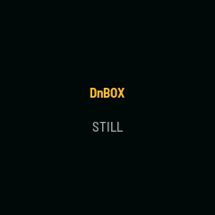

# Pending sample recovery and startup splash



An interpreted C replay reached the first startup splash after restoring a valid sample shadow into an erased live slot. The display contains all 57,600 pixels. Its decoded RGB SHA-256 equals the custom-text splash in the [previous native capture](../normal-loop/normal-loop.json).

| Run | Observation |
|---|---|
| Production guard, valid shadow | Loaded the matching owner and custom boot record, restored the 4,096-byte sector in 16 ordered 256-byte writes, scanned the sample header and CRC, erased the shadow and reached LCD initialization with no premature loop publication. The selected boot record rendered `DnBOX / STILL`. |
| Remove the production guard | The fixture detected a BREAK refresh with an unbound pattern table, emitted `PATTERN_UNBOUND` and stopped before creating the frame file. |
| Drop the ninth page write while reporting success | The byte comparison at LCD initialization emitted `BAD 71` and stopped before creating the frame file. |

| Output | Bytes | SHA-256 |
|---|---:|---|
| Panel-order RGB565 | 115200 | `3f3295b59fadf90714afffd3760db7ecced667ac52e82e5352e9849e4f0b546a` |
| Decoded RGB | 172800 | `af5f8a788579f1f844d3fcacd34782cb8fb55ae1a5d7c4c8a2efa053e521fb88` |
| Published PNG | 1046 | `597a551b25d861505841cc17145c9320b20787c65e48ef20016037c449a691e5` |
| Interpreted C input, uncompressed | 31117 | `b98c053758fb6a8f0b0654041afaff3fef0d75bc64f6b2c953f501dd3ef71364` |

## Reproduction

The exact C input is in [picoc-input.c.gz](picoc-input.c.gz), with its font bytes embedded. It runs in [PicoC, commit `61838f4e`](https://github.com/GregorR/picocjs-old/blob/61838f4eec9d72dbe1b4ce58e4a9d672c5915bf6/dist/picoc.asm.js), distributed script Git blob `3f435165195bdb76ee93baca18b6348b014e3064`. From this directory, run the command below with a local copy of that script. The optional output path must be new.

```sh
node replay.cjs /absolute/path/to/picoc.asm.js post-recovery.rgb565
```

The startup prefix comes from `fm1_main` through `draw_boot_screen` in firmware revision `4c05722d`, with the guarded `engine_brk_loops` from this change. The replay includes the storage-owner check, sample restore, slot header and CRC validation, boot record selection, text layout, blending, and blit calls. Flash, watchdog, sequencer dependencies, LCD transfer and selected palette are modeled. An unbound-pattern sentinel makes the failure deterministic. The interpreter input expands preprocessor choices and compiler builtins, strips qualifiers, and spells pointer checks explicitly for PicoC. The separate native startup test uses the full firmware routines and the registered host fixture.

The stock Barlow fonts are read from the [distributed Elite `94197fc8` package](https://github.com/gobbajogger/DnBOX-nightly/blob/gh-pages/artifacts/nightly-dev/95b3195f4767ef5df33b365197b01203873e5eec3d7fa497c73e5e509484a4a6/DnBOX-0.0.26-SMK37-Elite-94197fc8-hwtest.fwsc). The [font extractor](extract-splash-font.cjs) verifies the package and app-slot hashes, then unpacks the glyphs used for these strings into the firmware renderer’s uncompressed 4-bit representation. The archived screenshot supplied only the expected digest. The standalone PNG was encoded from the replay's framebuffer, decoded again and checked against that digest.

The [compiled seven-case replay](../../../../../../tests/ui_inventory/startup_loop.py) on `11bc3f3a` continued through project loading and the first regular UI frame. Startup restored 4,096 bytes in sixteen ordered writes. The already-live case cleared a stale shadow with zero writes to the live slot. Both cases reached the ordinary UI with the project pattern bound and the recovered BREAK slot visible. Their 240×240 frames share the decoded RGB SHA-256 `4f9674bf823d7edaba8c1f1a4770d2f9332eeeaae99ac741192e7cbf384916cc`. The recovery splash reproduced the archived custom text. [Seven-case receipts](../normal-loop/normal-loop.json) · [First ordinary frame](../normal-loop/startup-sample-recovered.png) · [Already-live control](../normal-loop/startup-sample-already-live.png) · [Stock Elite and Pro measurements](../../recovery-stock-fit.json).

The three additional state IDs link to the PNGs produced by the compiled host replay. The two first ordinary frames also match the archived matching-owner frame byte-for-byte. The case-by-case report records the observed capture digests. A compiled negative replaced only `engine.c` with its preceding revision from `4c05722d`. Undefined-behavior instrumentation of that translation unit diagnosed a null `struct pattern_t` access at line 3245 during recovery. The process exited 1 before producing the splash or the first ordinary frame.
