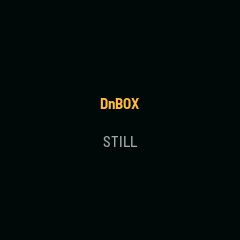
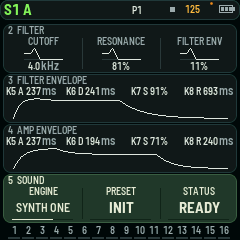
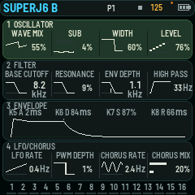

# Find a firmware screen

Use the [screen index](screen-index.tsv) to find a 240×240 capture by control, page, engine or startup state. Each row gives the evidence source, archive and PNG path, and the SHA-256 of the decoded RGB pixels. Paths are relative to this directory. An empty archive field means the PNG opens directly.

| Screen or action | What to look for | State ID or prefix |
|---|---|---|
| Normal power-on | Factory splash, then the first sequencer frame. A stored text or picture splash takes its place when present. | `startup/boot-`, `startup/startup-store-owned` |
| Recover a pending BREAK sample | Replay restores the sample and reaches the same regular frame as a cold start with the live sample already present. | `startup/startup-sample-recovered`, `startup/startup-sample-already-live` |
| Update countdown | Holding both octave buttons counts down. Releasing them returns to the regular UI. | `startup/update-` |
| Calibration, safe mode and retry | Follow button and encoder calibration, fault diagnostics, guarded boot and PLAY retry. | `native/` for the host and `stock/` for target captures |
| Synth One on ordinary stock firmware | **PARA** opens the bass controls. **K2** selects SOUND, **K5** chooses SYNTH ONE. INIT and READY are visible. A held note can defer a requested change. | `stock-init/` |
| Optional Synth One editor | With Sound #973 and the patch enabled, use **K2** for OSCILLATOR, FILTER, FILTER ENVELOPE, AMP ENVELOPE or SOUND. **K5–K8** edit the mapped columns. **SCALE** opens the list, **K2** scrolls, **K3** edits and **PATCH** closes it. | `synth-one/bass-A-page-`, `synth-one/list-B-factory-id-` |
| SuperJ6 on either bass part | In SOUND, choose SUPERJ6 with **K5**, then POLY, PAD, PLUCK or BRASS with **K4** or **K6**. **K2** selects one of the four parameter rows. The same sixteen macros are available through **SCALE**. | `superj6/slot-a-sound-`, `superj6/slot-b-matrix-`, `superj6/slot-b-list-` |
| Other playing, edited and historical states | Search the ordinary names directly. The two former stock Synth One placeholder pages have a historical prefix. | `live-`, `edited-`, `history/` |

The controls in this guide are for the SMK-37 Elite and Pro. Matrix edit columns start at K1 on FM-1. The optional editor exposes the 13 parameters of the admitted INIT patch. SuperJ6 uses the stock compact provider. The original programs and experimental importer have separate qualification. [Synth One ranges](../current/synthone-editor/README.md) · [SuperJ6 ranges and provider details](../current/superj6-slot/README.md)

| Startup after sample recovery | Optional Synth One SOUND | SuperJ6 oscillator |
|---|---|---|
|  |  |  |

From the repository root, these commands check every indexed PNG and extract a single control from its archive.

```sh
python3 tests/ui_inventory/screen_index.py docs/lanes/fwui/screens docs/lanes/fwui/screens/screen-index.tsv --check
cd docs/lanes/fwui/screens
rg '^(startup/|stock-init/|synth-one/|superj6/)' screen-index.tsv
tar -xOf ../current/synthone-editor/routes.tar.xz list-B-factory-id-16.png > /tmp/synth-one-cutoff.png
```

The full catalog was also painted into the published emulator shell at desktop and both phone sizes. [Viewport measurements and RGB comparisons](../current/panel-routes/viewport-replay.json)
